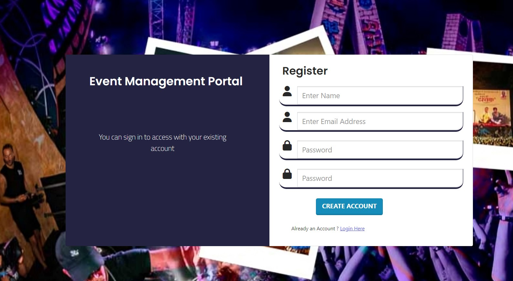
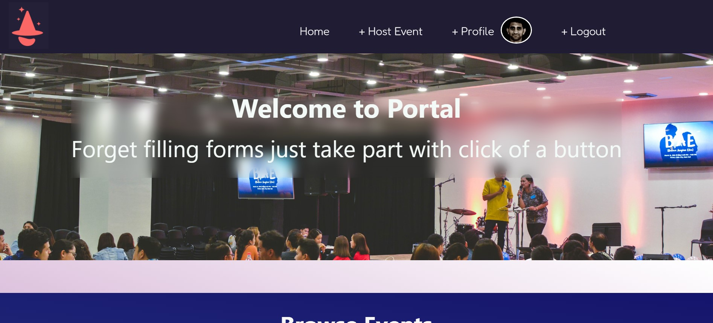
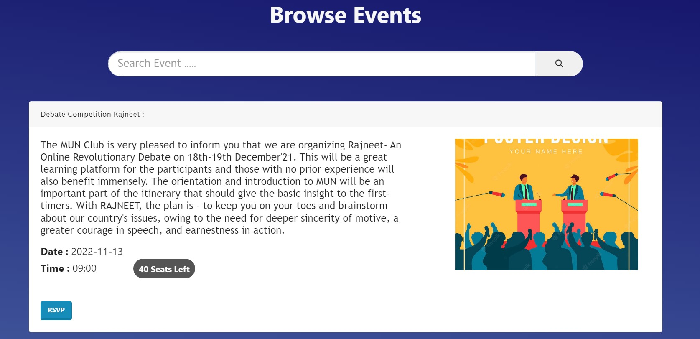
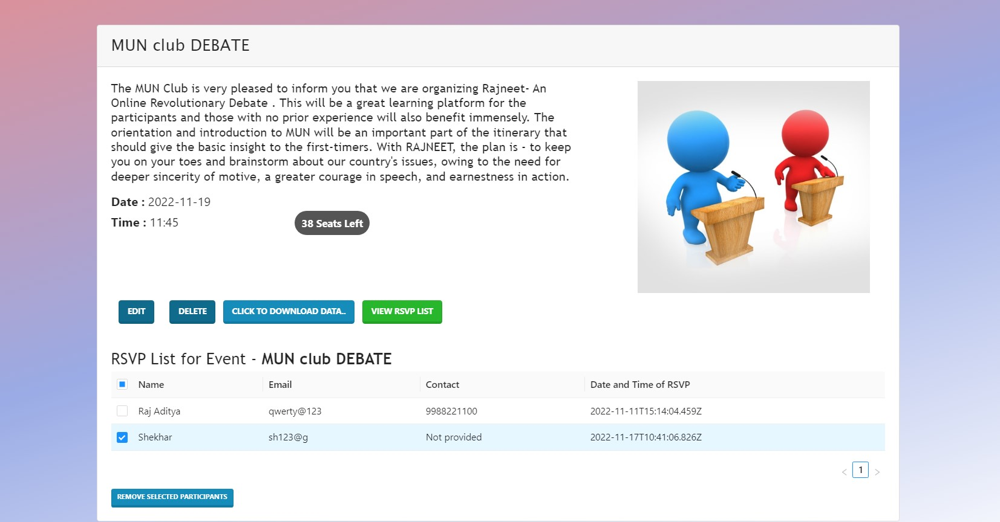

# Nucleus Portal

**A centralized event management platform designed to simplify event discovery, registration, and attendee management for college students and event organizers.**

## Overview

College clubs traditionally relied on Google Forms for event registrations, requiring students to repeatedly enter the same personal details for every event. This process was time-consuming for students and made attendee management cumbersome for organizers.

To address this, I developed a **college event management portal** that streamlines the entire registration process, allowing students to discover upcoming events and register with a single click.

## Key Features

### 1. One-Click Event Registration
- Students create a profile and enter their personal details only once.
- Register for multiple college events using a single **RSVP button**, eliminating repetitive form submissions.
- User profile information is automatically retrieved and recorded in the respective event's database.

### 2. Centralized Event Discovery
- Browse upcoming college events through a unified platform.
- Explore events organized by different college clubs.
- Simplifies event discovery and participation without relying on separately shared registration links.

### 3. Event & Attendee Management
- Event organizers can efficiently manage attendee registrations.
- Add or remove registered participants directly through the portal.
- View and maintain event-specific RSVP lists.

### 4. Excel Export
- Organizers can download complete RSVP and attendee lists in **Excel format**.
- Simplifies participant tracking, recordkeeping, and event coordination.

## Problem Solved

**For Students:** Eliminates the repetitive process of filling out Google Forms for every college event. Profile details are saved once and reused across registrations.

**For Organizers:** Replaces scattered registration forms with a centralized system for managing participants, updating attendee lists, and exporting registration data.

## Project Impact

- **Reduced Registration Friction:** Transformed multi-field registration forms into a single-click RSVP experience.
- **Improved User Experience:** Enabled students to discover and register for events from one platform.
- **Simplified Event Administration:** Provided organizers with tools to manage registrations and export attendee data efficiently.
- **Reusable Profile Data:** Eliminated redundant data entry by automatically populating event registrations from saved user profiles.

## Screenshots and Demonstration of Project
 
  Images of the website can be viewed in [Screenshots of project ](https://github.com/jjv1602/Event-management-portal/tree/main/Screenshot_Images)

  Complete demonstration video can be found in [Demo Video ](https://drive.google.com/file/d/1eDqIv5HaEB4Bk1Bfn2sLDKcnsAC_JUt1/view?usp=sharing)
   
1- Register Page <br>
   
<br>
2- Home Page <br>

<br>
3- Browse Events Page <br>

<br>
4- Organizer Page <br>

<br>
## Built with

* React Js
* Node Js
* Express
* Bootstrap 
* Mongo DB
* Ant Design UI 
## Run Locally

Clone the project

```bash
  git clone https://github.com/jjv1602/Event-management-portal.git
```

Go to the project directory

```bash
  cd Event-management-portal
```

Install dependencies

```bash
  npm install express
```

For running Backend
```bash
  npm start
```

Start frontend and backend both 

```bash
  npm run dev
```

